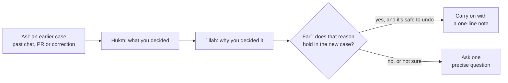

<picture>
  <source media="(prefers-color-scheme: dark)" srcset="https://raw.githubusercontent.com/zubair2005/skills/main/assets/qiyas-banner-dark.png">
  
</picture>

# qiyas

Load this skill when:

- you're bored of repeating yourself to your agents in every new chat
- you're setting an agent off on a long task and don't want it stopping halfway to ask something you've already decided

Before the agent asks you anything, qiyas makes it check your past chats, notes and pull requests for a decision you've already made. If it finds one, it works out why you made it, checks that the reason still holds, and carries on with a one-line note saying what it reused. If it can't tell, it asks you one precise question and keeps working on everything that doesn't depend on the answer.

Works with Codex, Claude Code and any agent that supports skills.

```text
$skill-installer install https://github.com/zubair2005/skills/tree/main/qiyas
```

## What it looks like

Two hours into a long refactor, the agent needs to open a pull request. Instead of stopping to ask how you like them, it finds your last two PRs and carries on:

```text
Qiyas: following your 3 Oct decision in "Fix login" (open PRs as drafts), since this is the same repo.
```

When something important has changed, it asks one question, with its recommendation:

```text
Your last two PRs went out as drafts, but this one touches billing. I'd keep it a draft so you can check it first. OK?
```

## How it works



The four steps come from qiyas, the method of analogy in usul al-fiqh:

| Step | Arabic | In usul al-fiqh | In the skill |
|---|---|---|---|
| Asl | أصل | the settled case | a past chat, PR or correction |
| Hukm | حكم | its ruling | what you decided |
| ʿIllah | علة | the reason for the ruling | why you decided it |
| Farʿ | فرع | the new case | the decision in front of the agent |

## Where it looks

- `AGENTS.md`, `CLAUDE.md` and any memory notes
- past Codex chats in `~/.codex/sessions/` and Claude Code chats in `~/.claude/projects/`
- pull requests and their review comments, through `gh`

It reads your own messages first, especially corrections like "no", "always" and "never". An assistant's reply only shows what you were responding to.

## What it won't do

- treat an old "yes" to deploy, merge, publish, spend money, change a customer account or delete data as permission for a new one
- count an assistant's summary or guess as your decision
- reuse a decision when the product, person, timing, stakes or authority has changed
- stretch a permission to a riskier case

Restrictions do carry over to riskier cases: if you blocked merging without tests, it won't deploy without tests either.

## Install

In Codex, ask the built-in installer:

```text
$skill-installer install https://github.com/zubair2005/skills/tree/main/qiyas
```

It lands in `~/.codex/skills/qiyas`. Codex usually picks up new skills by itself; restart it if `qiyas` doesn't appear.

In Claude Code, copy the `qiyas` folder into `~/.claude/skills/`.

Any other agent that supports skills can install it from the link:

```text
Install the AI agent skill at https://github.com/zubair2005/skills/tree/main/qiyas
```

## Make it the default

It already runs by itself when a request matches its description, and you can call it directly with `$qiyas` in Codex or `/qiyas` in Claude Code. To make it the first thing your agent tries before asking you anything, add this to `AGENTS.md` (Codex) or `CLAUDE.md` (Claude Code):

```text
Use the qiyas skill whenever understanding my intent or choosing an approach depends on my earlier decisions, corrections or preferences. Start with the closest relevant chats and my original messages, and widen the search only when evidence is missing or conflicts. Check for newer corrections and current facts, and never treat an old approval as permission for a new external action.
```

## Why it's called qiyas

> [!NOTE]
> Qiyas (قياس) means measuring one thing against another. In usul al-fiqh, the principles of Islamic jurisprudence, it is how jurists handle a case the Quran and Sunnah don't directly address: they find a settled case, identify the reason for its ruling, and carry the ruling over when the new case shares that reason. This skill borrows that structure for everyday work decisions. It gives no religious rulings, and your preferences carry no religious authority.

## License

MIT
